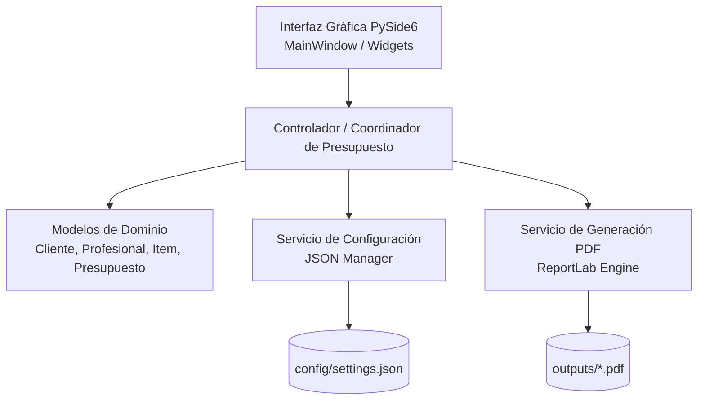

# Arquitectura del Sistema - FeeReport Lite

## 1. Visión General
**FeeReport Lite** es una aplicación de escritorio modular para la confección y emisión rápida de presupuestos profesionales en formato PDF, desarrollada en Python 3 con **PySide6** y **ReportLab**.

## 2. Componentes y Módulos

### `src/models/`
- **`cliente.py`**: Entidad `Cliente` (nombre, apellido, teléfono, email, validaciones).
- **`profesional.py`**: Entidad `Profesional` (nombre, apellido, teléfono, email opcional).
- **`presupuesto.py`**:
  - `ItemPresupuesto` (descripción, cantidad, precio unitario, subtotal de ítem).
  - `Presupuesto` (número correlativo o fecha, cliente, profesional, lista de ítems, porcentaje de impuesto/IVA, porcentaje de descuento, notas, totales computados).

### `src/services/`
- **`config_service.py`**: Carga, validación y persistencia de configuración de usuario y datos predeterminados del profesional.
- **`pdf_generator.py`**: Motor de maquetación en ReportLab Platypus. Genera el documento con:
  - Encabezado formal y numeración/fecha.
  - Bloques en dos columnas: Datos del Emisor (Profesional) y Datos del Receptor (Cliente).
  - Tabla de conceptos limpia con bandas sutiles, columnas alineadas numéricamente y totales destacados.
  - Bloque de resumen (Subtotal, Descuento, Impuesto/IVA, Total Final).
  - Términos, validez y pie de página numerado.

### `src/ui/`
- **`main_window.py`**: Ventana principal con diseño por paneles:
  - Panel superior: Datos del cliente y datos del profesional (con botón de guardar como predeterminado).
  - Panel central: Tabla interactiva de ítems con botones dinámicos para agregar, duplicar y eliminar filas.
  - Panel lateral/inferior: Parámetros financieros (moneda, % descuento, % IVA) y resumen numérico en tiempo real.
  - Barra de acciones: Generar PDF, Abrir PDF, Limpiar formulario, Guardar configuración.
- **`styles.py`**: Hoja de estilos Qt (QSS) con paleta limpia moderna (Slate / Neutral / Accent sutil) para evitar estilos genéricos y garantizar alta legibilidad.

### `src/utils/`
- **`formatters.py`**: Formateo de importes de moneda, porcentajes y fechas.
- **`paths.py`**: Gestión segura de rutas multiplataforma y resolución de assets tanto en desarrollo como dentro del empaquetado de PyInstaller (`sys._MEIPASS`).
